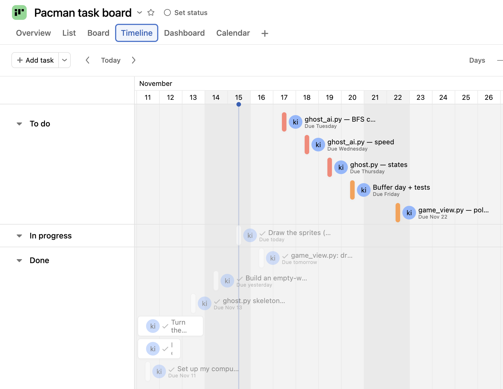

# Progress

## Week 1 (Nov 11–17)

### Jisoo
- Tested pygame on Python 3.14: it fails to install, so we use pygame-ce
  (same `import pygame`). Checked on Mac and school Linux.
- Studied the assigned mazegenerator package: real call, (x, y) order,
  wall bits (N=1, E=2, S=4, W=8), "42" cells = 15, global random seed.
- Wrote the day-1 decisions and the file ownership tree with Elvira.
- `game/grid.py`: directions, `can_move`, `ALL_WALLS`.
- `game/ghost.py`: skeleton (states and `Ghost` class).
- Packaging practice: PyInstaller build on school Linux, fixed missing
  assets with `BASE_DIR` and `--add-data`, uploaded a draft to itch.io,
  downloaded it and ran it.
- `ui/game_view.py`: `window_size`, `cell_to_pixel`, `draw_maze`,
  `draw_pacgums`, `draw_ghosts`, `draw_player`, fish decoration on the "42".
- `ui/sprites.py`: loads every sprite once into a dict.
- Sprites: rabbit, 4 cats, frightened cats (blue and white), leaf, carrot, 2 fish.
- `try_view.py`: temporary demo with fake data.
- Reviewed Elvira's first PR.

### Elvira
- (to fill)

## Next week (Jisoo)
- `ghost_ai.py`: BFS chase, speed, flee
- `ghost.py`: states and timers
- Tests, rabbit sprites for the other directions