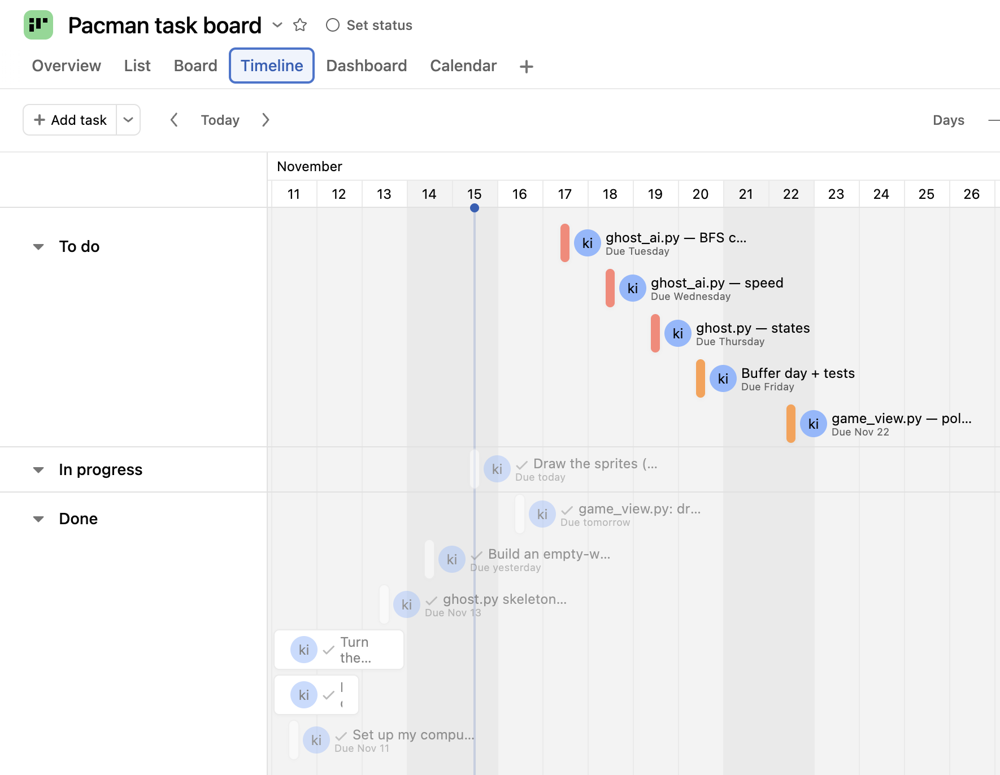
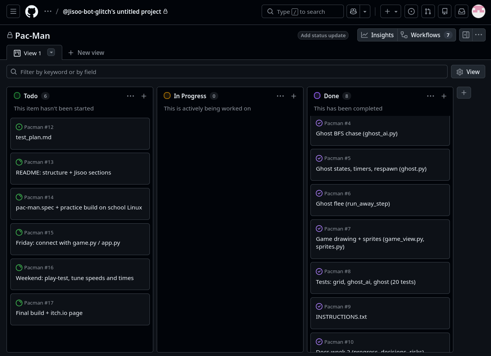

# Timeline

Project: Nov 11 – Dec 1 (3 weeks). Tasks were tracked in Asana (week 1), then on a GitHub Projects board in our repo (from week 2).

## Plan by week

| Week | Dates | Goal |
|---|---|---|
| 1 | Nov 11–17 | Maze drawn, player moves, first empty-window build on itch.io |
| 2 | Nov 18–24 | Ghost AI, scoring, levels, all screens |
| 3 | Nov 25–Dec 1 | Cheats, final packaging, docs, tests |

## Milestones

| Date | Milestone |
|---|---|
| Nov 11 | Day-1 decisions and file split agreed |
| Nov 17 | First PRs reviewed and merged into main |
| Nov 27 | All parts work together in one game (agreed on Nov 24) |
| Dec 1 | Final build on itch.io, docs done |

## Task boards

Week 1 (Asana):

Week 2 (GitHub Projects, after the Asana trial ended):

## Plan changes

| Date | Change | Why |
|---|---|---|
| Nov 14 | Ghost AI (BFS) moved from week 2 to Nov 16 | game_view.py was done early, and Jisoo may miss some days in week 2 |
| Nov 24 | Ghost personalities moved to "bonus, if time is left" | Not required by the subject (6.3). Saves time for the required parts |
| Nov 24 | Asana replaced by a GitHub Projects board | The Asana trial ended. The board is free and inside our repo |
| Nov 24 | First shared dates: Elvira's code playable Thu Nov 26, connect Fri Nov 27, play-test Nov 28–29, Mon Nov 30 kept as a buffer | Until now we only had the Dec 1 goal. We planned the last week together |